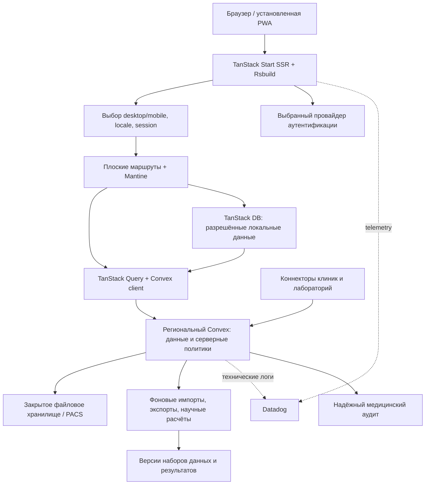

# Архитектура CURE

Дата: **28 октября 2026 года**. Статус: проект решения, без реализации. Источники проверены 27–28 октября 2026 года; конкретные версии зависимостей фиксируются после интеграционного прототипа.

## 1. Принятые требования

Репозиторий пуст. Наличие 10 000 пациентов, трёх ролей, фильтров, исследований, когорт, заявок, согласий, CSV, аналитики, организаций и журнала действий — целевое поведение первой версии, а не проверенная существующая реализация. Стартовые 10 000 пациентов должны быть синтетическими.

Приоритет: общая база и аккаунты → интеграции и качество данных → расширенные согласия и многоцентровая работа → научная аналитика и международное масштабирование. Базовые согласия, проверка прав, аудит и регион хранения нужны до первого импорта реальных данных; их нельзя целиком отложить до третьего этапа.

UI каждого маршрута находится целиком в одном файле плоской папки `src/routes`. Не создаём собственную библиотеку компонентов, дизайн-систему или обёртки над Mantine. Доменные функции, серверная авторизация, схемы, переводы, транспорт и наблюдаемость остаются отдельными модулями: требование про UI не дублирует бизнес-правила в страницах.

## 2. Основное устройство

Начальная система — одно SSR-приложение с доменными модулями и региональным Convex deployment. Интеграционные и научные вычисления выделяются в фоновые исполнители по мере появления реальных задач. Отдельные сервисы на каждую сущность на старте не нужны.



Convex — источник истины для операционных сущностей. TanStack Query отвечает за запросы, подписки и SSR hydration. TanStack DB применяется там, где действительно нужны локальные коллекции, производные выборки или офлайн-черновики; не копирует всю серверную базу в браузер. Научные расчёты не выполняются в React и не должны становиться длинными транзакциями Convex.

Совместимость Start с Rsbuild/Rspack подтверждена [официально](https://tanstack.com/blog/start-adds-rsbuild-support). Реактивная связка Convex с Query и [Start SSR](https://docs.convex.dev/client/tanstack/tanstack-start/) тоже документирована. Проверка всей выбранной комбинации — этап E0, а не следствие наличия отдельных интеграций.

## 3. Авторизация — решение до реализации

**Запрошенный вариант: `@convex-dev/auth`.** Библиотека остаётся beta; готовый Start SSR adapter и стандартный полноценный MFA-процесс не подтверждены публичной документацией. Email OTP как способ входа сам по себе не доказывает наличие второго фактора. [Convex Auth](https://labs.convex.dev/auth).

**Рекомендация для промышленного варианта: Convex + Better Auth**, если разрешена замена auth-пакета. Есть официальный [Start SSR guide](https://labs.convex.dev/better-auth/framework-guides/tanstack-start) и поддержка Two Factor; Organization plugin требует Local Install и расширения схемы. Это другой продукт авторизации. Пример Start содержит Vite-настройки, поэтому адаптацию SSR bundling к Rsbuild обязательно проверить. [Поддерживаемые плагины](https://labs.convex.dev/better-auth/supported-plugins).

Если именно Convex Auth обязателен, E0 должен доказать поддерживаемый путь SSR cookies, refresh, logout, CSRF-защиты и MFA без приватных импортов библиотеки. При отсутствии такого пути сочетание требований остаётся нерешённым; нельзя заменять SSR авторизацию клиентской проверкой и называть задачу выполненной. Другая допустимая альтернатива — внешний OIDC-провайдер с MFA, но это также изменение auth-части стека.

Во всех вариантах регистрация создаёт аккаунт без доступа к клиническим данным. Приглашение одноразовое, с истечением срока и привязкой к подтверждённому адресату; принятие не позволяет назначить себе роль выше разрешённой отправителю. Для чувствительных операций проверяется действительность и, где предусмотрено политикой, свежесть MFA. Восстановление аккаунта и отзыв сессий входят в основной сценарий, а не откладываются как настройка UI.

## 4. Организации, роли и доступ

Права выражаются назначениями в контексте организации, исследования и центра. Один пользователь может быть врачом в клинике и исследователем в другом проекте. Роль не хранится единственной строкой в профиле.

| Роль | Основная область полномочий |
|---|---|
| Администратор организации | Команда, приглашения, настройки; административная роль сама по себе не открывает медданные |
| Исследователь | Протокол, критерии, разрешённые когорты и результаты |
| Пациент | Собственные согласия, дневник, визиты, разрешённые результаты |
| Врач | Пациенты своего центра, проверка соответствия критериям, клиническое подтверждение |
| Координатор | Набор, визиты, задачи центра, полнота форм |
| Биостатистик | Утверждённые версии обезличенных/псевдонимизированных наборов и расчёты |
| Этический комитет | Назначенные рассмотрения, решения, условия и версии документов |
| Спонсор | Разрешённые агрегаты, бюджет, прогресс; без автоматического доступа к индивидуальным данным |
| Аудитор | Ограниченный по цели и сроку доступ к доказательствам и журналам |

Три исходные роли пользователем не названы. Их нельзя выдумывать как существующую модель: точные стартовые роли фиксируются в E1 из перечисленных выше полномочий.

Каждый серверный запрос проверяет: идентичность → действующее членство → разрешённое действие → связь ресурса с организацией/исследованием/центром → цель и область grant → применимая версия согласия → срок → региональную политику. `organizationId` из URL или аргумента не считается доказательством членства. Выдаваемые поля и агрегаты также проходят фильтрацию доступа. Чувствительная заявка не одобряется собственным заявителем; полномочия рассмотрения проверяются отдельно.

Проверки повторяются в фоновых заданиях, экспорте, AI tools и при replay офлайн-операций. SSR redirect и отсутствие кнопки только помогают интерфейсу; доступ обеспечивает Convex/серверный путь выдачи. Истечение grant проверяется по времени при обращении, а не только периодическим cron. Само течение времени не перезапускает реактивную query: зависимости от membership/grant/consent обеспечивают инвалидацию при изменении записей, expiry материализуется scheduled mutation. Для строгого прекращения выдачи по сроку индивидуальные данные проходят повторно авторизуемую серверную операцию; бессрочная подписка с одной стартовой проверкой недостаточна. Уже переданные браузеру данные нельзя «забрать обратно».

## 5. Доменные данные

| Область | Основные сущности и связи |
|---|---|
| Identity | `users`, `organizations`, `sites`, `memberships`, `invitations`, `studyMemberships`; сессии и факторы — у auth-провайдера |
| Исследования | `studies`, неизменяемые `protocolVersions`, `studySites`, `milestones`, `tasks`, `budgetVersions` |
| Пациенты | Локальная клиническая идентичность у центра; исследовательские `subjects`, `enrollments`, привязка пациента к аккаунту после проверки личности |
| Данные | `clinicalRecords`, `observations`, `medicationOrders`, `specimens`, `fileReferences`, `sourceVersions`, `importRuns`, `qualityIssues` |
| Согласия | `consentTemplates`, `consentVersions`, `consentDecisions`, `ethicsReviews`, `accessRequests`, `accessGrants`, `revocations` |
| Проведение | `formDefinitions`, `formVersions`, `formResponses`, `visits`, `deviations`, `adverseEvents`, `safetyReviews`; отдельный защищённый контур распределения групп |
| Аналитика | `cohortDefinitions`, `cohortSnapshots`, `datasetVersions`, `analysisPlans`, `analysisRuns`, `reportVersions`, `shareGrants` |
| Работа и наука | `discussions`, `documents`, `authorshipContributions`, `researchRequests`, `grantOpportunities`, `fundingApplications`, `publications` |
| Контроль | `auditEvents`, `domainEvents`, `deliveryAttempts`, `idempotencyRecords`, `regionalPolicies` |

Это логическая карта, а не требование создать все таблицы сразу. Схема появляется по этапам. Индексы строятся под ограниченные запросы по организации/исследованию/центру, а списки имеют пагинацию. Нельзя выгружать все клинические записи в браузер для фильтрации.

Для изменяемых объектов важны `version`, статус, автор и время изменения; для источников — source ID, исходная версия, время события и получения, версия преобразования. Для подписанных согласий, опубликованных протоколов и наборов анализа создаются новые версии вместо перезаписи истории. Правки eCRF сохраняют причину, автора и предыдущее значение.

Исследовательский идентификатор пациента изолирован по проекту/центру. Глобальный открытый ID для сопоставления людей между организациями не создаётся. При возможности повторного связывания с человеком данные остаются персональными, даже если имя заменено кодом. [Различие анонимизации и псевдонимизации](https://www.edpb.europa.eu/topics/ai-and-technology/anonymisation-pseudonymisation_en).

## 6. Маршруты, SSR, mobile/desktop

Пример будущей структуры, все файлы маршрутов — на одном уровне:

```text
src/routes/__root.tsx
src/routes/index.tsx
src/routes/login.tsx
src/routes/register.tsx
src/routes/d.tsx
src/routes/d.studies.index.tsx
src/routes/d.studies.$studyId.tsx
src/routes/d.cohorts.tsx
src/routes/m.tsx
src/routes/m.studies.index.tsx
src/routes/m.studies.$studyId.tsx
src/routes/m.patient.diary.tsx
src/routes/m.patient.visits.tsx
src/routes/api.auth.$.ts       # только если выбран Better Auth
src/router.tsx
src/start.ts
src/i18n/
src/data/
src/observability/
convex/schema.ts
convex/organizations.ts
convex/studies.ts
convex/consents.ts
convex/access.ts
convex/lib/
```

Точки в именах выражают URL-иерархию при плоской файловой структуре. `d.tsx` и `m.tsx` — сами layout routes с полным Mantine shell и `Outlet`, а не извлечённые пользовательские компоненты. Каждая страница содержит собственную разметку. Дополнительный ручной реестр маршрутов не нужен: типы и дерево генерирует Router.

Нейтральный вход, например `/studies/123`, сервер перенаправляет в `/d/studies/123` или `/m/studies/123` до SSR. Приоритет выбора: явное предпочтение в cookie → доступный mobile Client Hint → User-Agent → desktop. Это эвристика, поэтому нужен ручной переключатель; планшеты по умолчанию получают desktop. Персонализированные ответы и redirect не попадают в общий публичный cache.

Mobile — свой сценарий: пошаговые формы, карточки, короткая навигация, дневник и визиты. Desktop — плотные таблицы, сравнение, настройка когорт и отчётов. Переключатель сохраняет сущность и допустимые query-параметры; перенос hash реализует браузер/клиент, сервер его не получает. Обычная клиентская навигация остаётся в выбранной ветке. Не переопределяем UI по ширине окна во время hydration и не используем CSS breakpoints для выбора варианта.

## 7. Mantine, язык и тема

Используем стандартные `@mantine/core`, `hooks`, `form`, `dates`, `notifications`, `modals`, `charts`, `dropzone`, `spotlight` по потребности. Редактор — `@mantine/tiptap`, если нужны форматированные документы; сам пакет редактора не предоставляет совместное редактирование, его протокол требует отдельного решения. Пакеты не подключаются только ради формулировки «вся экосистема». [Каталог Mantine](https://mantine.dev/getting-started/).

Без theme overrides, собственных CSS-тем и форков компонентов. Штатные `MantineProvider`, `ColorSchemeScript` и переключение light/dark/system; корневой route содержит провайдеры. Первым выбором для хуков остаётся Mantine, `@siberiacancode/react-use` подключается только для конкретной отсутствующей возможности.

`@gratise/i18n`: RU/EN с первого этапа. На SSR-запрос создаётся отдельный translator; клиент получает тот же locale/catalog snapshot. Язык интерфейса, страна обработки и часовой пояс — три разных настройки. Момент события хранится в UTC, timezone визита — IANA ID, дата без времени сохраняется как дата. Переводы форм согласия/опросников имеют медицинское согласование и собственные версии; автоматический перевод не публикует их сам.

## 8. Локальные данные и PWA

SSR QueryClient, состояние auth и i18n изолируются на запрос. В браузере клиенты и локальные коллекции принадлежат конкретному аккаунту и контексту организации. При logout/переключении контекста подписки завершаются, replay останавливается, допустимые кэши очищаются; параллельные вкладки получают смену контекста.

В TanStack DB есть отдельные механизмы сохранения коллекций и очереди операций: [SQLite persistence и offline transactions](https://tanstack.com/db/latest/docs/installation). Они не делают Convex автоматически офлайн-базой. Связка Query Collection с Convex должна пройти проверку реактивных обновлений и завершения optimistic mutations.

PWA первого этапа кэширует статические assets и отдельную безопасную offline-страницу. Офлайн разрешены настройки и явно разрешённые нечувствительные черновики. Индивидуальные клинические данные, согласия и результаты запрещены в Cache Storage, IndexedDB, OPFS, persisted Query/DB cache и outbox. Service worker также не сохраняет токены и персонализированный SSR HTML; защищённые HTTP-ответы имеют `no-store`. Это проверяется осмотром всех browser stores после работы и logout. Расширение офлайн-дневника пациента — отдельный последующий сценарий с согласованной моделью локальной защиты; оно не включено автоматически.

Для разрешённых офлайн-команд: стабильный idempotency key → серверная дедупликация → проверка актуальных прав и версии → подтверждение. «Сохранено локально», «отправляется», «подтверждено сервером», «конфликт/отказ» различаются в UI. Конфликт клинических значений не разрешается молча последней записью. Очередь переживает перезапуск, но отказ в доступе не уходит в бесконечные повторы. У уже отключённого устройства невозможно гарантированно отозвать ранее сохранённую копию.

## 9. Интеграции и качество

Поток: адаптер источника → проверка схемы → карантин → преобразование кодов/единиц → проверки качества → разрешённая публикация версии → обновление когорт. Для каждого запуска нужны checkpoint, source ID/version, идемпотентность, ограниченные повторы, список нерешённых ошибок и возможность повторить выбранную запись.

FHIR используется для согласованных профилей обмена, а не как обещание универсальной совместимости с любой МИС. Первым контрактом можно взять FHIR R4, если его поддерживает пилотная клиника; версия и профили фиксируются на источник. Для происхождения данных — [FHIR Provenance](https://hl7.org/fhir/R4/provenance.html). Для изображений — DICOM/DICOMweb; [PS3.18](https://dicom.nema.org/medical/dicom/2025d/output/html/part18.html) описывает обмен объектами, но сам не решает авторизацию CURE.

Справочники и единицы версионируются: клинические коды, лабораторные показатели, UCUM-совместимые единицы; условия лицензирования терминологий проверяются для выбранных стран. Исходное значение и единица сохраняются рядом с нормализованными. Нельзя автоматически объединять вероятные дубли пациентов или домысливать пропущенные медицинские значения: такие случаи попадают на рассмотрение.

Первая интеграция — один реально согласованный источник плюс CSV импорт/экспорт. Носимые устройства, университетские хранилища и лаборатории добавляются через те же контракты. Изображения, геномные файлы и большие результаты — в региональном закрытом хранилище/PACS; Convex хранит метаданные и доступ. Прямая постоянная ссылка `storage.getUrl()` не подходит для отзыва клинического доступа: [она не истекает](https://docs.convex.dev/file-storage/overview). Для строгого отзыва нужен авторизованный путь скачивания; даже короткоживущая ссылка имеет остаточное окно доступа.

## 10. Согласия, исследования и безопасность участников

Согласие содержит документ и его версию/язык, идентифицированного подписанта, способ подтверждения, цели, категории данных, допустимых получателей, срок и контекст исследования. Подпись не сводится к checkbox. FHIR Consent может представлять ограничения и метаданные, но сам не исполняет серверные политики. [FHIR Consent](https://hl7.org/fhir/R4/consent.html).

Отзыв блокирует новые выдачи и экспорты, закрывает применимые grants, инвалидирует подписки и отменяет ещё не выполненные задания. Уже начатые jobs повторно проверяют разрешение перед публикацией. Для ранее сформированных наборов фиксируется затронутая версия и решение по дальнейшему использованию. Правила хранения, удаления и обязательного сохранения доказательств зависят от страны и исследования; согласие на участие не подменяет все правовые основания обработки.

Многоцентровая работа: версия протокола → принятие каждым центром → локальные роли/задачи → цели набора → визиты → контроль сроков и бюджета. Поправка к протоколу отмечает, какие центры её приняли и кому требуется новое согласие. У каждого перехода статуса есть допустимая роль и проверяемые условия.

Подбор участников выдаёт «подходит / не подходит / недостаточно данных» по версии критериев, со ссылками на факты, датами и объяснением. Отсутствие значения не равно отсутствию заболевания. Решение о включении подтверждает уполномоченный врач; поиск редких заболеваний ограничивает раскрытие малых групп и повторные уточняющие запросы.

Проведение включает версионированные eCRF, проверки и запросы уточнений, окно визитов, протокольные отклонения, фиксацию/разблокировку данных. Рандомизация и ослепление — самостоятельный валидируемый механизм с сокрытием распределения и контролируемым раскрытием; продуктовые A/B-флаги к нему не относятся.

Нежелательное событие проходит цепочку регистрации, назначения ответственного, оценки, уведомления, подтверждения получения, эскалации и закрытия с историей решения. Сроки задаются протоколом и применимой политикой. Push/email не считается доказательством рассмотрения. Для испытаний процессы валидируются с учётом применимых принципов GCP; наличие функций в интерфейсе не означает соответствие стандарту. [ICH E6(R3), публикация FDA](https://www.fda.gov/regulatory-information/search-fda-guidance-documents/e6r3-good-clinical-practice-gcp).

## 11. Научная аналитика и AI-отчёты

Научный результат привязан к версии протокола, определения когорты, снимка данных, словарей, кода, окружения, параметров и random seed. Хранятся план анализа и заранее зарегистрированные гипотезы. Повторный запуск создаёт новую запись с сопоставлением результатов. Набор данных фиксируется на определённый момент; изменяющаяся realtime-выборка не называется воспроизводимым снимком.

Для сравнений, размера выборки, моделей, пропущенных данных и оценки смещений используются проверяемые научные библиотеки в изолированных R/Python jobs. Статистик задаёт допущения, методы и допустимые проверки; UI показывает их вместе с результатом. OMOP — перспективная модель региональных аналитических наборов, а не обязательная замена всей операционной схемы Convex. [OHDSI](https://www.ohdsi.org/data-standards/). CDISC ODM/CDASH/SDTM/ADaM рассматриваются по типу исследования и требуемым обменам, а не внедряются все одновременно. [CDISC](https://www.cdisc.org/standards).

AI-конструктор: запрос пользователя → разрешённые метаданные/агрегаты → структурированная спецификация отчёта → серверная проверка схемы и прав → расчёт → Mantine UI → сохранение версии. Спецификация содержит только разрешённые блоки: текст, KPI, таблица, график, фильтр, источник/метод. LLM не поставляет исполняемый JSX, SQL или JavaScript. Рендеринг спецификации остаётся внутри файла маршрута отчёта, согласно правилу про компоненты.

TanStack AI управляет генерацией и tools, но данные и научные расчёты выдаёт проверенный серверный инструмент. Учитываются лимиты стоимости/времени, отмена, ошибки, prompt injection в загруженных документах и отсутствие разрешения у инструмента. Контент документов является данными, а не инструкциями для выдачи доступа. На старте внешней модели передаются только разрешённые обезличенные агрегаты; условия обработки и регион провайдера выбираются отдельно.

Шаринг — `shareGrant` на конкретную версию отчёта с получателем/организацией, сроком и отзывом. Получатель проходит авторизацию и собственную проверку прав; автор не может делегировать больше, чем ему разрешено. Публичная ссылка допускается лишь для отдельно утверждённого публичного агрегированного результата. Экспорт и открытие журналируются. WebMCP добавляется как необязательное улучшение поиска/навигации; критические операции работают без него. [WebMCP](https://tanstack.com/ai/latest/docs/tools/webmcp).

## 12. Международная работа и надёжность

Общая база означает совместное состояние участников внутри разрешённого контура, а не обязательную одну глобальную базу медицинских записей. При расширении создаются региональные deployment/хранилища, маршрутизация организации к своему региону и версии политик. Регион нельзя реализовать одним полем `country` в общей таблице. Доступные регионы и перенос данных проверяются до подключения страны. [Convex regions](https://docs.convex.dev/production/regions).

Для федеративного анализа пакет с версией кода и критериев выполняется рядом с данными клиники; наружу выходят разрешённые проверенные агрегаты. Объединение учитывает различия схем, версий и качества. Малые группы и последовательные запросы могут раскрывать информацию даже без исходных строк; нужны пороги и контроль выдачи.

TLS, управление ключами и секретами, ограничение сервисных аккаунтов, резервирование данных/файлов/конфигурации, восстановление в тестовом контуре и проверка всех связанных артефактов входят в эксплуатацию. Конкретные RPO/RTO фиксируются по проверенной конфигурации и репетиции восстановления. Региональная политика охватывает также auth, telemetry, резервные копии и AI, а не только основную БД.

Convex snapshots не включают код, environment variables и ожидающие scheduled functions; периодические backups требуют Pro. Восстановление планируется вместе с конфигурацией, файлами, задачами и реестром отзывов после snapshot. До возобновления доступа контур закрыт: сессии инвалидируются, последующие отзывы сверяются с независимым долговечным журналом, expiry jobs восстанавливаются. Если полноту истории разрешений подтвердить нельзя, соответствующие grants остаются закрытыми до повторного разрешения. Для пилота можно проверить цели RPO ≤24 ч и RTO ≤4 ч; для клинических процессов значения определяются отдельно и доказываются учением. Пользовательский PITR в изученной документации не подтверждён. [Backup & Restore](https://docs.convex.dev/database/backup-restore).

Для надёжного аудита реактивной выдачи у Convex есть `log.audit`, включая cache hits; доступен на Enterprise dedicated deployment с собственным S3. Доставка допускает дубли; прямой вызов из action не поддержан. На обычном тарифе индивидуальные данные выдаются по контролируемому серверному пути, который проверяет доступ и сохраняет аудит до ответа. Это фиксирует выдачу, а не доказывает, что человек прочитал экран. [Convex audit logging](https://docs.convex.dev/production/integrations/audit-logging).

При обычном транзакционном журнале отказ оформляется так, чтобы запись о нём сохранилась: `insert audit`, за которым следует `throw` в той же mutation, откатит запись. Нужен сохраняемый результат отказа с преобразованием в HTTP/API-ошибку после фиксации либо поддерживаемый долговечный audit-механизм. Прямые query, файлы и альтернативные API не должны обходить выбранный путь выдачи.

Решение по Datadog, SLO, аналитике, A/B и откату подробно описано в [отдельном документе](observability-and-release.md). Ни 100% SLA, ни наблюдение абсолютно всех клиентских ошибок не обещаются. Принятые границы измеряются, потери telemetry контролируются, а критические действия имеют отдельные доказательства.
